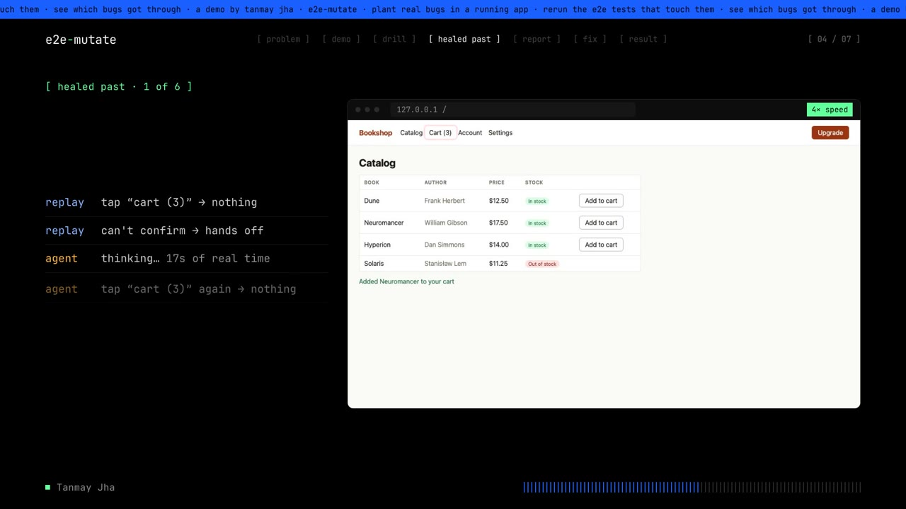
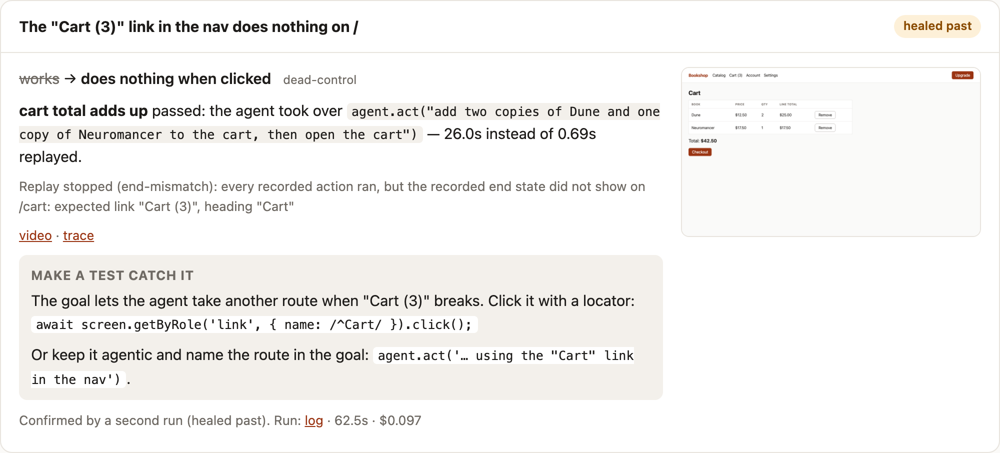

# e2e-mutate

**Would your e2e tests catch a bug?** e2e-mutate finds out. It plants realistic bugs in your running web app, one at a time, reruns the [e2e](https://github.com/e2e-inc/e2e) tests that touch each one, and reports which bugs your tests caught and which got through.

It also catches what only an agentic test suite can do: a test that **heals past** a bug. When a recorded step stops matching the app, e2e hands the step to its agent, which finds another way to reach the goal. That's how e2e keeps tests green through UI changes. Sometimes it also keeps them green through a real regression: the agent routes around a broken button and the test passes. e2e-mutate shows you every case where that happened.

[](demo/e2e-mutate-demo.mp4)

<sub>The 1:39 narrated demo film, built from the real runs. Click to open [`demo/e2e-mutate-demo.mp4`](demo/e2e-mutate-demo.mp4); captions are in `demo/e2e-mutate-demo.srt`.</sub>

## What it found on the demo

A small bookshop with a 7-test e2e suite (`demo/`). e2e-mutate planted 40 bugs, then planted the same 40 again after the suite was tightened by following its report:

| | First suite | After following the report |
|---|---|---|
| Bugs caught | **27 of 40 (68%)** | **36 of 39 (92%)** (1 flaky, not scored) |
| Healed past by the agent | 6 | 1 |
| Got through | 7 | 2 |

Some of what the first suite let through:
- **The "Cart" link in the nav did nothing, and the test passed.** Replay tapped it, the agent tapped it again, then opened `/cart` directly.
- **A confirmed order said "Pending", and the checkout test passed.**
- **The profile save answered OK but stored nothing.** "Profile saved" showed, and `agent.assert('the profile was saved')` passed.
- **The order total was `display: none`, and `expect(getByTestId('order-total')).toHaveText('$12.50')` passed.** A test-id query matches hidden nodes, so a deterministic check had a gap too.

Each drill took 8–9 minutes, at $1.93–$2.37 of e2e's estimated model cost. Details: [demo/RESULTS.md](demo/RESULTS.md).

This is the report's card for the dead "Cart" link. It shows the step the agent took over, how much slower it was than the replay, the screen the test ended on, and the check that would have caught the bug:



## On e2e's own testbed

I also ran it on a suite I didn't write: `apps/testbed` from e2e's repo, the 587 tests the e2e team uses to test the framework itself. I added one config line and changed nothing else.

- **32 of 40 bugs caught (80%)** in 23 minutes, at $0 (the testbed has no agent steps).
- I read the 8 that got through against the tests. Each test checks something else on purpose: it picks a row by name, so a row swap doesn't matter, or it is a selector test that reads a hidden element's text or disabled state, as e2e documents.
- The first full run also found problems in e2e-mutate, which are now fixed and tested:
  - steps that wrap their trigger
  - tests that catch an expected failure and go on
  - setup tests that fail because of the bug
  - buttons with no click handler, where a "does nothing" bug changes nothing

Details: [field/e2e-testbed/README.md](field/e2e-testbed/README.md).

## How it works

1. **Baseline.** It lists your tests with `e2e list`, then runs them once with a small recorder injected as an e2e init script. The recorder notes what each test touched:
   - money values, counts and status words on screen
   - elements with a test id
   - lists
   - the controls the test clicked, and whether anything listens for their clicks
   - every `fetch` and its JSON

   Then it replays the tests from a fresh copy of the cache. A test only counts if it passes again and every `agent.act` replays without the model (`cache.mode: 'self-finalized'`).
2. **Plant bugs.** From what the tests touched, it builds bugs of 9 types. They are planted at runtime, in the browser. No source file is changed.

   | Type | Example |
   |---|---|
   | wrong number | `$42.50` shows as `$52.50` |
   | wrong word | `Out of stock` says `In stock` |
   | missing element | the order total isn't shown |
   | dead control | the "Upgrade" button does nothing |
   | swapped rows | the first two rows of a list swap places |
   | server error | `POST /api/order` answers 500 |
   | lost write | `PUT /api/profile` answers OK but saves nothing |
   | wrong API value | the cart API returns a different price, with **totals kept consistent** |
   | missing API item | the cart API drops a book, with **totals kept consistent** |

   The last two keep totals consistent on purpose. A screen that contradicts itself gets caught even by a vague `agent.assert`, because the model does the arithmetic. A screen that is consistent but wrong is the real gap.

   It skips bugs that can't change anything a test could see ("equivalent mutants"). A "does nothing" bug blocks the click, so it is not planted on a control with no click listener on it or above it, no `onclick` and no default action. Those controls are listed in the report instead.
3. **Run.** For each bug it runs only the tests that touched its target, in a separate `e2e run`, with a fresh copy of the baseline cache. The bug's script logs `[e2e-mutate] applied <id>` whenever it actually changes something, and e2e's `appLog` records when, and in which step. Tests that share a source line (made in a loop) count as one unit, because e2e selects tests by `file:line`.
4. **Classify** each bug:

   | Outcome | Rule |
   |---|---|
   | ✓ **caught** | a test, or a setup test it needs, failed after the bug first applied: the step that failed it was still running then or started later, or the test failed after its last step (a timeout counts too) |
   | ⚠ **healed past** | every test passed, and an `agent.act` that replayed fully in the baseline handed off to the agent |
   | ✗ **got through** | every test passed with the bug applied |
   | not reached | the bug never applied in any test, or the test never ran |
   | inconclusive | a test failed before the bug applied (noise, rerun once) |
   | flaky | the confirm run disagreed |

   Every bug that got through or healed past is **run a second time** and reported only if both runs agree. **Catch rate** = caught ÷ (caught + healed past + got through).
5. **Report.** It writes a terminal summary, `.e2e-mutate/report.html` and `.e2e-mutate/drill.json`. For each bug that got through, the report shows:
   - the screen the test saw
   - the check that let the bug through
   - a concrete stronger check to add

## Use it

Add one line to your e2e config:

```ts
import { web } from '@e2e-dev/web';
import { mutate } from 'e2e-mutate';

export default {
  targets: [{ engine: web({ initScripts: [...mutate()] }), app: { url: 'http://127.0.0.1:0', command: { /* … */ } } }],
  // …
};
```

`mutate()` returns `[]` in normal runs, so your suite doesn't change. Then:

```sh
npx e2e-mutate                       # drill every test
npx e2e-mutate tests/checkout.e2e.ts # or some of them
```

| Option | Default | |
|---|---|---|
| `--max-mutants <n>` | 30 | Most bugs to plant. Picks rotate across bug types, and within a type favor the test that has been drilled least. |
| `--types <list>` | all | Bug types to use. |
| `--concurrency <n>` | 1 | Bug runs at once. For more than 1, use `app.url` port `0` so every run gets its own app. |
| `--budget-usd <n>` | | Stop starting runs once e2e's estimated cost passes this. |
| `--ignore <file>` | `.e2e-mutate-ignore.json` | Bugs to skip, by title, for bugs that don't matter (for example a list order that doesn't matter). |
| `--out <dir>` | `.e2e-mutate` | Everything the drill writes. |
| `--cache-dir <dir>` | `.e2e/cache` | Your replay cache. It's only ever copied. |
| `--no-confirm`, `--no-video` | | Skip the confirm runs or the videos. |
| `--clean-env` | | Run e2e with a minimal environment. Needed when you start it from inside a Claude Code session, so the nested Claude Code agent (through `@e2e-dev/acp`) uses its own login. |

## Safety

- **Your replay cache is never written.** Every run, baseline included, gets its own copy (`--cache-dir`). The drill compares a digest of your cache before and after, and warns if it changed.
- **Your `.e2e/` output is never touched.** Every run writes under `.e2e-mutate/runs/`.
- **Your source and tests are never edited.** The drill compares `git status` before and after, and warns about any change outside `.e2e-mutate/`.
- **The drill's own data stays local.** The recorder posts only to a collector on `127.0.0.1`. Agent steps still go to whatever model your e2e config uses, as in any e2e run. e2e's telemetry follows your settings (`--clean-env` turns it off).

## How it relates to e2e's defect check

e2e's `migrate-to-e2e` skill has an optional **defect check** ([#1167](https://github.com/e2e-inc/e2e/pull/1167)): during a migration, a coding agent edits one bug into the app's source, rebuilds, runs the old and new suites with `--no-cache`, and reverts. e2e-mutate is the automated, suite-wide version of the same idea:

| | e2e defect check | e2e-mutate |
|---|---|---|
| When | during a migration, opt-in | any time, on any suite |
| Bugs | 1, chosen and edited by hand into the source | up to `--max-mutants`, built from what the tests touched, planted at runtime, no source edits |
| Healing | not visible (`--no-cache` turns replay off) | detected: a step that replayed in the baseline hands off and the test still passes |
| Output | one row in `MIGRATION.md` | catch rate per test, a report with the screen, the check that missed it, and a suggested fix |
| Rule for a catch | "a failure before that step is not a catch" | the same rule, by time: the bug's `appLog` line against the failing step's start and duration |

## Built on public e2e APIs only

It needs no change to e2e. It uses:
- `web({ initScripts })` to inject the recorder and the bugs
- `e2e list --reporter json`
- `e2e run` with `--output`, `--cache-dir`, `--retries 0`, `--trace=on` and `--video`
- fields that are already in `report.json`: `step.cache.mode`/`reason`/`detail`, `step.startedAt`/`durationMs`, `appLog[].step`/`at`, `result.kind`, artifacts and `usage.estimatedCostUsd`

It is tested against `e2e` 0.23.1 and `@e2e-dev/web` 0.16.0.

## Limits

- **Web only.** Mobile would need a way to inject screen and network changes into agent-device.
- **Network bugs patch `window.fetch` only.** `XMLHttpRequest`, which axios uses in browsers, is not covered yet. Neither is data the server renders into HTML.
- **No backend or database bugs.** It only changes what the browser sees or receives.
- **"Does nothing" means the click does nothing.** The bug blocks the `click` event, so a control driven only by pointer or touch events (a long-press button, say) keeps working. When nothing listens for its clicks, no such bug is planted on it. But in an app that listens at its root, as React does, every control counts as live; a "does nothing" bug on a control that opens on `pointerdown` then changes nothing, and its "got through" is a false miss.
- **No serial groups.** They are skipped with a notice. Neither are configs with a custom `cache.store`, or with the cache forced to off, read-only or strict, because the baseline can't record under those.
- **Model verdicts vary.** The confirm run filters most noise, but results are measurements, not proofs.
- **The recorder reports over HTTP.** It posts to the collector on `127.0.0.1`, so a test that intercepts or counts every request sees those posts. Such a test fails its baseline record run and is left out of the drill, with the reason, rather than misread. On e2e's testbed this was 2 of 584 tests.
- **Server errors and lost writes are simulated in the page.** `fetch` answers without sending anything, so a test that watches the network or the server sees no request at all. That still fails the test and counts as a catch, but for a different reason than a real 500 would give.

## Develop

```sh
npm install
npm run check   # oxlint, tsc, vitest
```

`demo/` has the bookshop app and its suite. See [demo/README.md](demo/README.md).
